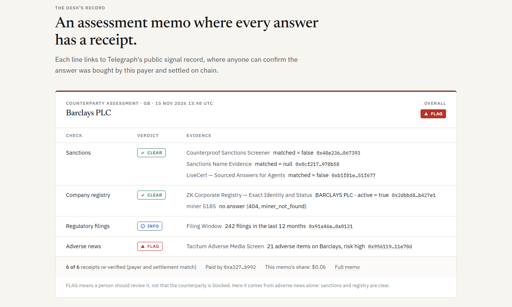
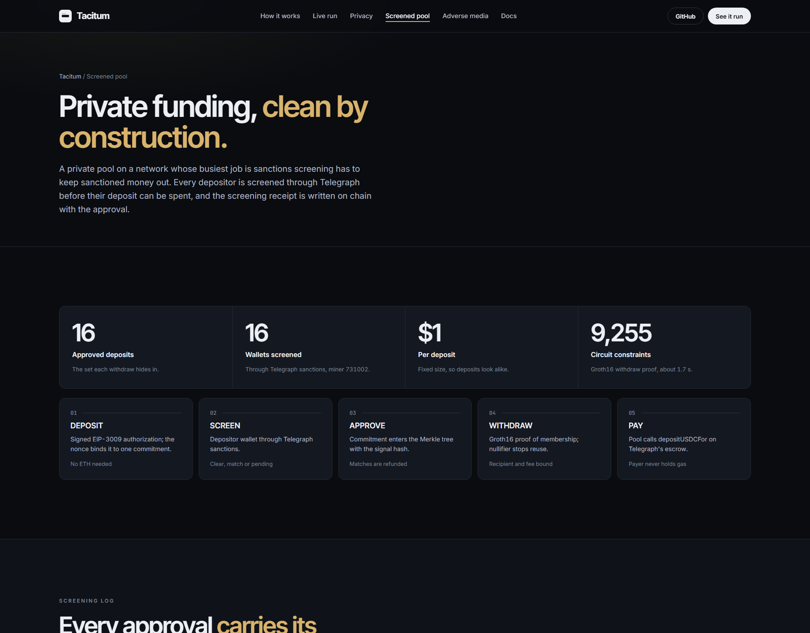
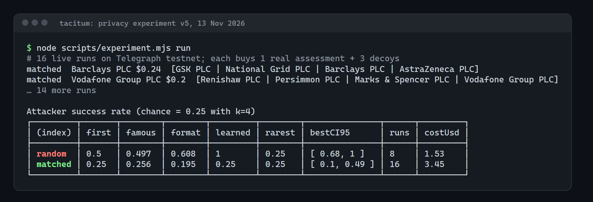

# Tacitum

[](https://github.com/tomcode1000/tacitum/actions/workflows/test.yml)
[](docs/assets/test-summary.json)
[](https://github.com/tomcode1000/tacitum/actions/workflows/codeql.yml)
[](https://54-255-109-186.sslip.io)
[](https://telegraphprotocol.com)
[](https://anjoman.ai/dashboard/explore/miners/tacitum-adverse-media)

**The private, compliant buying layer for [Telegraph](https://telegraphprotocol.com). Screen anyone. Tell no one. Prove everything.**

Tacitum is the dark pool for due diligence. Agents and desks buy counterparty checks hidden among decoys, paid from a sanctions-screened pool, with every answer receipted on Telegraph and a sealed record that only the auditor's key can open.

Telegraph Hackathon Season II, two entries:
- **Track 01, Apps & Agents** (Mission 03, Institutional Markets): Tacitum itself, this README.
- **Track 02, Miners / Providers**: the `tacitum-adverse-media` miner, [active on Anjoman](https://anjoman.ai/dashboard/explore/miners/tacitum-adverse-media); see [miner/README.md](miner/README.md). Blind-test precision 0.91, recall 0.71.

| | |
|---|---|
| **Hidden from the market** | Who was screened (real target among matched decoys; attackers within sampling error of chance: best 0.31, 95% interval 0.18–0.49, 32 live runs) and who asked (payer funded by a zero-knowledge withdraw) |
| **Clean by construction** | Every pool depositor is sanctions-screened through Telegraph before their money can be spent; the receipt is on chain with the approval |
| **Provable to anyone** | Every answer keeps its Telegraph receipt; 6 of 6 verified in the live run |
| **Open to the auditor** | Each assessment is sealed to an auditor key; the auditor re-checks all 27 claims of the live run against public data |
| **Tested** | 40 automated tests, run in CI on every push with CodeQL scanning: circuit, Merkle tree, audit envelope, spend caps, screening fallback, watchlist monitor, supplier-payment rules, privacy tracer, headline classifier, and the pool contract on a local chain (deposits, screening, reclaim, withdraw, double spend, bound recipients) |

**Judges:** [EVIDENCE.md](EVIDENCE.md) is a two-minute path with a verify link for every claim. [THREAT-MODEL.md](THREAT-MODEL.md) covers who can learn what, and the mainnet checklist.


## In one live run (15 Nov 2026, Sepolia)

- A desk's deposit entered a pool where **every depositor is screened through Telegraph sanctions** first. The pool now holds 16 approved deposits.
- A zero-knowledge withdraw funded a **brand-new payer from the pool**, so the desk's wallet never appears.
- The payer bought a full assessment of Barclays PLC **among 3 matched decoys**. Over 32 live runs the best attacker picks the real company 31% of the time (95% interval 18–49%) against a blind 25%.
- News came from **our own adverse-media miner**, registered on Telegraph.
- **6 of 6 receipts** verify against Telegraph's public signal record.





Run the site locally: `npm run web:build && npm run web`, then open http://localhost:8080 (pages: How it works, Live run, Privacy, Screened pool, Adverse media, Docs). Full run instructions are on the Docs page (`web/docs.html`); design rules are in [DESIGN.md](DESIGN.md).

## The problem

Every paid Telegraph request is public. `GET /daemon/api/questions` lists the question text, and `GET /engine/v1/signal/{hash}` adds the paying wallet, the answer and the settlement transaction. No login is needed for either.

A desk that screens a counterparty through Telegraph tells everyone watching who it is screening, and which wallet is doing it. Funds, legal teams and listing desks cannot use the network that way.

## Journey

**Decoys that hold up (4–13 Nov).** Each real assessment is bought together with 3 decoys. With random decoys our attacker found the real one every time. Five rounds later, after matching fame, name format, registry answers and SEC filings, and fixing the decoy groups across runs, every attacker is at chance.



| Version | Best attacker (chance 0.25) | Change |
|---|---|---|
| random | 1.00 | none |
| v1 | 0.50 | match fame and name format |
| v2 | 0.57 | match registry answers |
| v3 | 0.45 | match SEC filer status |
| v4 | 0.38 | match filing volume |
| v5 | 0.25 | fixed decoy groups, re-probed miners |

## What Tacitum does

An agent assesses a counterparty (sanctions, company registry, on-chain activity, filings) with intelligence bought through Telegraph, and:

- **hides the payer**: each purchase comes from a one-time wallet funded from a pool that only screened depositors can enter
- **hides the question**: the real request is sent among paid decoys drawn from the live feed
- **keeps the proof**: every receipt stays verifiable, and an auditor's viewing key reveals the full record
- **measures the privacy**: an attacker model is run against our own traffic and its success rate is published

It is a layer on top of Telegraph. Every answer is still bought from Telegraph miners.

## Status

- [x] Testnet payer wallet and x402 client (`npm run wallet`, `npm run first-call`)
- [x] First paid call: one $0.01 sanctions screen, settled in tx `0x26bbada3…09fad1` on Sepolia. The public feed shows our wallet and the question (`evidence/`)
- [x] Counterparty assessment workflow (`npm run assess -- "Barclays PLC" GB`), see PLAN.md
- [x] Decoy engine and privacy measurement: matched decoys at k=4; best attacker 0.31 (95% interval 0.18–0.49) over 32 live runs (v6), within sampling error of the blind 0.25. v5 (16 runs): 0.26 [0.10–0.49]
- [x] Private mode v0: decoys plus a one-time payer per assessment (`npm run private`); funding still linkable on chain
- [x] Cover sets: decoy groups are fixed and shared, so bundles look the same whichever member was wanted and repeat screens reveal nothing (`data/cover-sets.json`)
- [x] Library and MCP server (`tacitum`, `tacitum-mcp`), below
- [x] Screened funding pool (removes the funding link): v2 on Sepolia with reclaim after 24h; contract tested on a local chain
- [x] Audit records sealed to an auditor key (`node scripts/audit.mjs open <file> --verify`): 27 of 27 claims verified for the live run

## Use it in your project

```bash
npm install github:tomcode1000/tacitum
```

You need a Sepolia key with some test USDC and a little ETH (`npm run wallet` in this repo makes one). It is only the **funder**: it pays into a fresh one-time wallet's Telegraph escrow, and that wallet buys the answers.

```js
import { tacitum } from "tacitum";
import { privateKeyToAccount } from "viem/accounts";

const t = tacitum({ funder: privateKeyToAccount(process.env.FUNDER_KEY), k: 4 });

// Counterparty screen among 3 matched decoys: sanctions (two miners), registry, filings, news.
const { memo, assessment } = await t.assess({ name: "Barclays PLC", jurisdiction: "GB" });

// Any intent, with decoys you supply (same params shape, plausible values).
const { answer } = await t.ask("SANCTIONS_SCREENING_MATCH_GENERAL", { name: "Acme Trading Ltd" }, {
  decoys: [{ name: "Brindle Supplies Ltd" }, { name: "Corvel Logistics Ltd" }, { name: "Dunmore Metals Ltd" }],
});
```

```js
// Ongoing monitoring: re-screen a watchlist for adverse media every day, each name among decoys.
const run = await t.monitor([{ name: "Tesco PLC", jurisdiction: "GB" }, { name: "BP P.L.C.", jurisdiction: "GB" }]);
```

From this repo: `node scripts/monitor.mjs watchlists/uk-suppliers.json [--pool]` saves the run to `assessments/monitor/` and prints what changed since the last run. Run it from cron or a systemd timer for daily monitoring.

Spend caps are on by default: at most $0.10 per miner payment and $2.00 per `tacitum()` instance. Pass `maxPerPaymentUsd` / `maxTotalUsd` to change them. A call that would pass the cap throws before any money moves.

Pool mode: pass `pool: { relayer }` (a separate wallet with Sepolia ETH) and each one-time payer is funded by a zero-knowledge withdraw from the screened pool instead of by the funder. `t.deposit()` adds the funder's deposit; `t.poolStatus()` shows the approved set.

A private call takes at least two minutes: the node only sees a new escrow deposit after a delay, and a payer it has seen empty is refused until the epoch closes, so Tacitum waits before the first paid call.

State (caches, cover sets, one-time keys) goes to `./.tacitum`, or `TACITUM_HOME` / `TACITUM_KEYS`. Keep the keys: they are what lets you open the record for an auditor.

### As an MCP server

```bash
claude mcp add tacitum -e TACITUM_FUNDER_KEY=0x... -- npx -y github:tomcode1000/tacitum
```

Tools: `private_assess` (name, jurisdiction, k) returns the memo; `private_ask` (intent, params, decoys, minerId) returns only the real answer; `pool_deposit` and `pool_status` manage the screened pool. Set `TACITUM_RELAYER_KEY` to fund payers from the pool, `AUDITOR_PUBKEY` to seal every record for an auditor, and `TACITUM_MAX_PAYMENT_USD` / `TACITUM_MAX_TOTAL_USD` to change the spend caps.

### What it hides, and what it does not

- Hidden: which counterparty you cared about (one of k, measured against attackers in `data/privacy-results.json`), and the link between this question and your other questions (a new wallet each time).
- Without pool mode, the funding deposit is on chain, so the one-time wallet can be traced to the funder. Pool mode removes that link: the payer is funded by a zero-knowledge withdraw, and the funder is one screened depositor among the approved set.
- The full picture (screener, relayer, auditor, node operator, timing) is in [THREAT-MODEL.md](THREAT-MODEL.md).
- Decoys you pass to `ask()` are only as good as they are plausible. A famous name among made-up ones hides nothing.

## Run (this repo)

Node 20 or later.

```bash
npm install
npm run wallet       # creates a testnet-only key in .env and mints test USDC once it has Sepolia ETH
npm run first-call   # one paid sanctions screen, then prints what the public feed shows about it
npm run probe        # tests candidate miners against known answers (about $0.15)
npm run assess -- "Barclays PLC" GB   # full counterparty memo, about $0.06
npm run private -- "Barclays PLC" GB  # same memo, bought among 3 decoys by a one-time wallet, about $0.21
```
